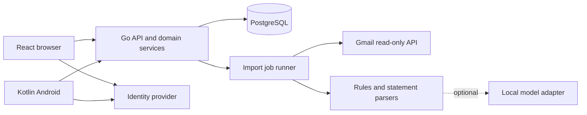

# Architecture and API

## Components



One Go deployable on Render Free serves API and web assets, backed by Supabase Free PostgreSQL and Auth; target Singapore for both services. This hosting selection is accepted in [ADR 0004](../adr/0004-first-hosted-version.md). Unattended-processing infrastructure remains undecided until Gmail integration. Jobs share domain services and PostgreSQL. Long jobs can later run as a separate process using the same binary; a dedicated background worker is not assumed to be free. Clients never write financial tables directly. No LLM is on the required dashboard or manual-entry path.

## Proposed repository layout

```text
apps/web/                  React/TypeScript frontend
apps/android/              Kotlin/Compose Android project
services/api/cmd/folio/     Go server and optional worker commands
services/api/internal/     domain, HTTP, persistence, import, insight modules
services/api/migrations/   ordered PostgreSQL migrations
api/openapi.yaml           versioned API contract
fixtures/                  synthetic financial and parser test cases
infra/                     local compose and deployment notes
```

This is a planned layout; these applications do not exist yet. Keep domain code independent of HTTP and provider SDKs. Use dependency injection through small Go interfaces, particularly for clocks, parsing, mail, and model providers.

## Authentication and authorization

Selected managed identity provider: Supabase Auth with a single invited owner; disable public signup. Verify JWT issuer, audience, signature, expiry, and owner subject in Go. Account ownership is checked on every read, export, attachment, and write, not just at login. Keep database credentials exclusively in the backend. In the selected Supabase PostgreSQL project, isolate app tables from public Data API access and enable appropriate RLS/privilege restrictions as defense in depth; do not assume a privileged backend connection is protected by RLS.

For web, use an established auth integration with a backend-managed session: OAuth authorization code/PKCE → server callback → secure HttpOnly SameSite session cookie. Store refresh credentials server-side encrypted; rotate sessions, enforce CSRF protection on state-changing requests, and validate allowed redirect destinations. Serve web and API on one origin. For Android, use the system browser and authorization code with PKCE; store refresh credentials encrypted using Keystore-backed storage and keep access tokens short-lived. Never embed a client secret in the APK. Recheck revocation policy and logout behavior in implementation.

Local development uses a seeded dev identity behind an explicit development-only auth mode. The production process must refuse to start with this mode. Integration tests must also exercise real JWT validation and owner isolation; a bypass is not a production authentication design.

Gmail connection authorization is separate from application login, even if both use Google. Disconnecting Gmail must not erase accounting history or log the user out of Folio.

## API conventions

Base `/api/v1`. JSON uses snake_case, ISO dates, UUID IDs, and minor-unit integer strings. Lists use cursor pagination. All mutation requests include a client-generated UUID `Idempotency-Key`; repeat key and identical body returns the stored result, while reuse with different body returns 409. Retain keys at least 30 days, and retain source/event uniqueness independently. Use version/ETag preconditions for edits; return 412 for stale revisions. All successful responses carry request IDs.

Errors use `{ "error": { "code": "MONTH_CLOSED", "message": "Reopen October before changing it", "fields": {}, "request_id": "..." } }`. Use 400 malformed, 401 unauthenticated, 403 unauthorized, 404 absent/inaccessible entity, 409 domain conflict, 412 stale version, 422 invalid financial data, 429 throttled, and 503 unavailable dependencies. Do not leak raw provider errors or sensitive values.

| Endpoint | Contract |
| --- | --- |
| GET/PATCH `/settings` | Currency/timezone; disallow currency change after postings without migration |
| GET/POST `/accounts` | Create/list owned accounts; archive through versioned PATCH |
| GET/POST `/entries` | List/create income, direct expense, transfer/allocation, refund, payment |
| POST `/entries/{id}/corrections` | Reasoned correction/reversal with expected version |
| GET/POST `/statements` | List/create statement summaries; unknown fields remain null |
| POST `/statements/{id}/revisions` | Correct active revision; retain source and settlements |
| POST `/statements/{id}/settlements` | Link all/part of existing payment; no second cash entry |
| GET/POST `/balance-snapshots` | Dated observations; not inferred account balances |
| GET/PUT `/months/{yyyy-mm}/plan` | Expected lines and actual matching, with optimistic concurrency |
| GET `/months/{yyyy-mm}/summary` | Deterministic actuals, forecasts, coverage, and revision |
| POST `/months/{yyyy-mm}/close` or `/reopen` | Checklist/reason and expected version |
| POST `/imports` | File/pasted summary ingestion; returns 202 job and source IDs |
| GET `/imports/{id}` | Status, failures, review candidates; no client-side polling storm |
| GET `/drafts` | Pending records and possible duplicates |
| POST `/drafts/{id}/accept` or `/reject` | Atomic state transition, idempotent |
| POST `/gmail/connect`, GET `/gmail/callback` | OAuth initiation and verified state/PKCE callback |
| POST `/gmail/sync`, DELETE `/gmail/connection` | Bounded sync request; revoke/disconnect |
| POST `/capture/text` | Typed or transcribed text to draft; never posts directly |
| GET `/months/{yyyy-mm}/insights` | Rule-based insights; optional generated wording |
| GET `/exports` | Portable JSON/CSV download with schema version |

During the contract phase, enumerate schemas and transitions for every endpoint before generating clients. The table is an implementation outline, not a substitute for OpenAPI validation.

Example income command:

```json
{
  "kind": "income",
  "amount_minor": "500000",
  "currency": "SGD",
  "effective_date": "2026-10-25",
  "reporting_month": "2026-10",
  "account_id": "11111111-1111-4111-8111-111111111111",
  "category": "salary"
}
```

Example summary fragment:

```json
{
  "month": "2026-10",
  "currency": "SGD",
  "income_minor": "500000",
  "known_spending_minor": "250000",
  "allocation_minor": "80000",
  "monthly_surplus_minor": "170000",
  "is_provisional": false,
  "missing_items": [],
  "revision": 8
}
```

When spending is unknown, retain known subtotal, return `monthly_surplus_minor: null`, and expose a separately labeled `provisional_surplus_minor`. Include per-account observed_at values for snapshots. Forecast response includes plan-line contributions so the client can explain totals without recomputing them.

## Client synchronization

Online-first reads and writes. Cache static web assets only initially; do not service-worker-cache API responses or exports. Android may retain an explicitly labeled last-seen summary in encrypted storage later, but initial release can require connectivity. Never show cached data as current. On timeout, reuse the same mutation key and query status before creating another draft. A stale edit shows the newer record and asks for reconciliation; never silently overwrite it. Offline editable drafts and multi-device conflict resolution are deferred work, not hidden MVP requirements.

## Contract additions from the source workbook

Include the funding-boundary and claims extension from [the accounting contract](02-accounting-and-data.md). Add authenticated/versioned endpoints for claims and receipt matching, reconciliation periods, recurrence history, and a read-only legacy comparison report. Account settings include effective-dated funding-boundary membership. Entry kinds include envelope funding/return and reimbursement receipt; do not treat these as income.

Month summary adds funding inflows/outflows/remainder, projected funding remainder, gross spending, confirmed recoveries, net personal cost, unmatched claims/receipts, and separate cash/spending completeness indicators. The client labels legacy comparison, funding remainder, and spending surplus distinctly; all are computed by Go. A receipt/claim match transaction must enforce allocation limits and idempotency just like a statement settlement. A source observation cannot generate a second receipt when imported again.
